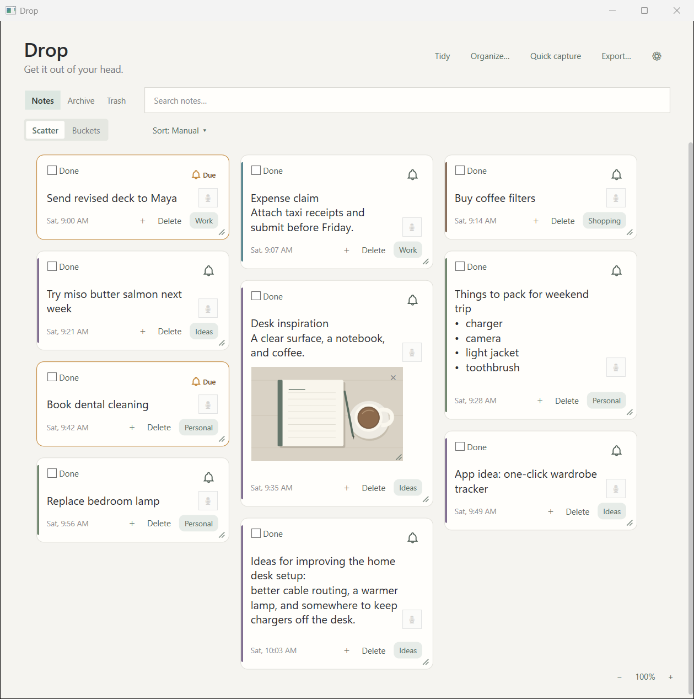
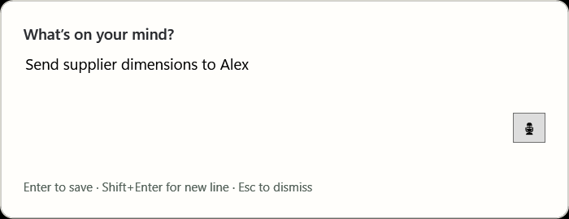
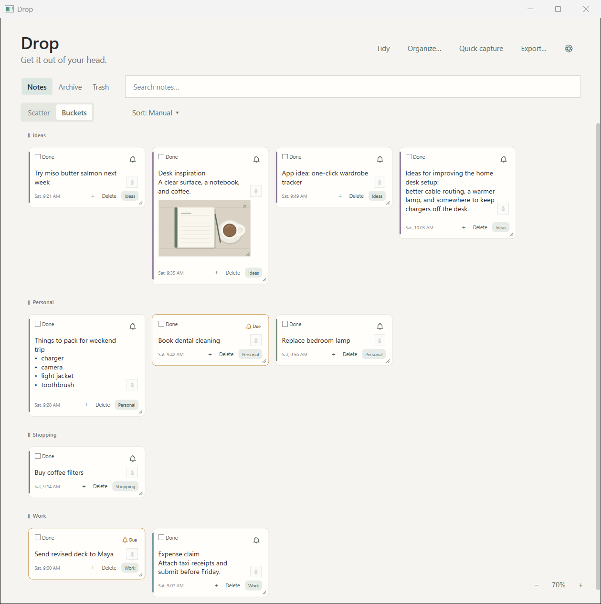
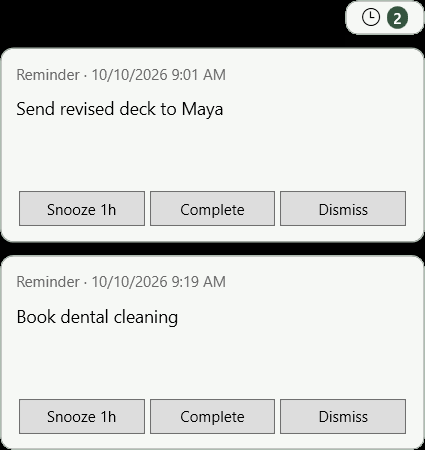

# Drop

**Get something out of your head in seconds, and have it come back when it matters.**

Fast, local-first notes and reminders for Windows. Drop gives your thoughts, tasks,
and small reminders a place to land while you get on with your day.

[Download the latest installer](https://github.com/raskinbobbies/drop-app/releases/latest)
 · [All releases](https://github.com/raskinbobbies/drop-app/releases)
 · [Installation](#install-drop) · [Your data](#your-data-stays-local)

> Public downloads are not available yet. The download links will become active
> when the first approved installer is released.
>
> Screenshots below are previews from a development candidate, using fictional
> demo notes. Appearance and available features may differ in the released version;
> check its release notes for details.



## Capture in seconds

Press **Ctrl+Alt+Space**, type a thought, and press **Enter** to save it without
opening the main window. No bucket or reminder is required.

**Shift+Enter** adds a new line. **Esc** dismisses Quick Capture; its draft is kept
for the running session. The global shortcut and save/newline keys are configurable.



## A calm place for everyday notes

- **Notes at a glance.** Edit directly in cards and arrange them in Manual order.
- **Local search.** Press **Ctrl+K** to find note text and bucket names in the current
  view, including Archive or Trash when selected.
- **Simple organization.** Keep a dumping ground in Scatter, or use Buckets for
  work, personal tasks, shopping, and ideas. Each note has one primary bucket.
- **Rules when you want them.** Categorize matching notes automatically; manual
  choices take precedence. Tidy reapplies rules and archives completed notes.
- **Completion without losing your place.** Mark a note Done to stop its reminders.
  It stays in place until you archive it or use Tidy.
- **Archive, Trash, and export.** Restore notes from Archive or Trash, or export
  active and archived notes as Markdown. Trash is purged after 30 days at startup.



## Bring it back when it matters

Use a note's bell to choose a reminder time, or type a supported instruction such
as `remind me in 30 minutes` or `remind me tomorrow at 9am` while capturing a note.

Reminders offer **Snooze**, **Complete**, and **Dismiss**. Snooze schedules a later
time; Complete marks the note Done; Dismiss hides the current attention item without
completing the note or scheduling a snooze. Unresolved reminders appear in a small
in-app pill that expands to show their cards.



Windows notifications depend on your notification settings and device policies.
Workplace compatibility, every power/resume scenario, and every monitor/DPI setup
have not been established. Check the release notes for the tested scope of each build.

## Optional extras, still local

Attach JPEG or PNG images, paste clipboard images, and use lightweight bold,
italic, strikethrough, and list formatting. Imported images are copied into Drop's
local data folder.

Optional voice input transcribes on your computer. It requires **Windows 11 x64**,
a supported CPU, a microphone, and a separately downloaded speech model. Model
downloads happen only when requested and require internet access; installed models
can be used offline. Typed notes do not require voice setup.

## Install Drop

### Windows requirements

- **Windows 10 version 2004 (build 19041) or later, or Windows 11**, on an x64 PC.
  These are the installer targets, not a promise of validation on every device.
- A standard Windows user account. The installer is designed for per-user use.
- No separately installed .NET runtime or account is required for the core app.
- Internet access to obtain the installer and, optionally, speech models. Core
  notes and reminders work offline.

### Download and setup

1. Open [the latest release](https://github.com/raskinbobbies/drop-app/releases/latest).
2. Read its release notes and download **`Drop-<version>-Setup.exe`** from **Assets**.
   GitHub's automatically generated source archives contain this documentation;
   they are not the application installer.
3. Run the installer. It installs Drop under `%LOCALAPPDATA%\Programs\Drop`, adds a
   Start menu shortcut, and creates an uninstall entry.
4. Launch **Drop** from the Start menu, then try **Ctrl+Alt+Space**.

Closing the main window keeps Drop in the tray. Choose **Quit** from the tray menu
to exit. Uninstalling the app leaves your local Drop data intact.

Signing status is stated in each release. Windows or workplace policies may warn
about or block an installer; follow your organization's approval process.

If a release includes `SHA256SUMS.txt`, compare its installer hash with:

```powershell
Get-FileHash -Algorithm SHA256 -LiteralPath '.\Drop-<version>-Setup.exe'
```

The checksum checks that your download matches the published file. It is not a
substitute for a trusted download source or a digital signature.

## Your data stays local

Drop stores notes, buckets, rules, reminder state, settings, attachments, and any
installed speech models under **`%LOCALAPPDATA%\Drop\`** on your computer.

The core app requires no account, cloud sync, telemetry, or server. Voice
transcription runs locally rather than sending audio to a cloud transcription
service. Requesting model downloads uses the network to retrieve model files.

Local-first describes where data lives; it is not a claim of encrypted storage or
protection from other software with access to your Windows profile. Back up data
you care about. For upgrades, follow the release's instructions and avoid running
an older version against data upgraded by a newer one.

## About this repository

This repository contains public documentation and preview images. Windows
installers are distributed through [GitHub Releases](https://github.com/raskinbobbies/drop-app/releases)
and are not committed to Git. Maintainers can follow the
[manual publishing guide](docs/PUBLISHING.md).

**Drop is proprietary software.** Application source code is not published here.
No open-source license or permission to redistribute the application or these
assets is granted by this repository.
